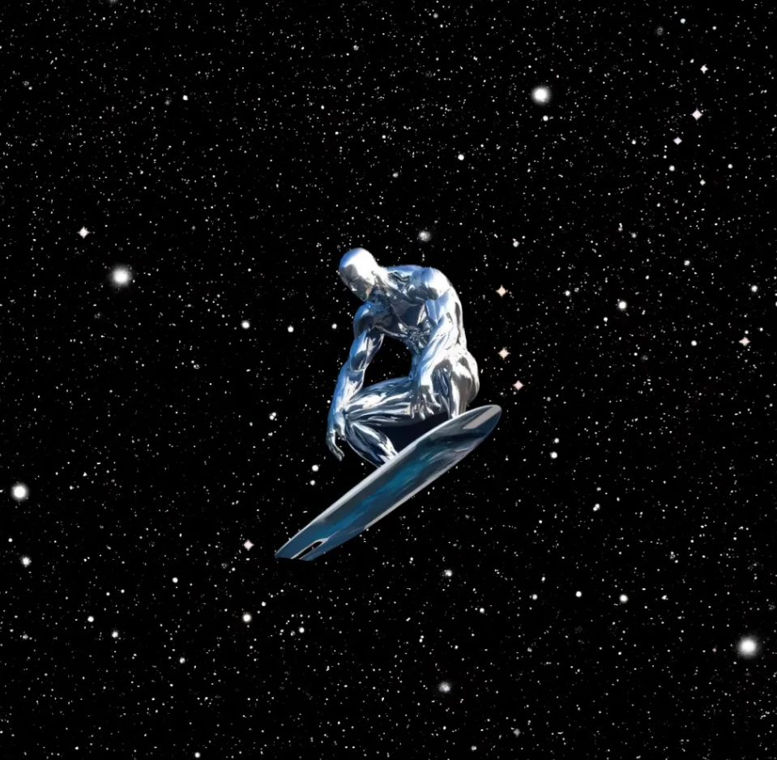

# VIscosity (miamiwalk base)



VIscosity is now **miamiwalk** by **siilber** (trustno1's VIctory-NVIDIA with codec-d/cool_fox's memory
admission, and two days of siilber's work on an RTX 5070 / Ryzen 7 7700) with a few fixes from VIscosity on top.
On an RTX 5070 Ti it draws a cleaner picture than VIscosity's cool_fox base, at the same speed, so it is the base
here. Thanks to siilber for the tree, the measurements and the help. The earlier cool_fox-based VIscosity is kept
in the branch `viscosity-coolfox`.

What it adds to miamiwalk:

- **HID gamepads** (including the vendor-0x054C pads, with rumble), read directly where XInput does not list them:
  no extra mapping tool needed (marquezini).
- **Mouse-look** for the keyboard's stand-in pad (`VICTORY_MOUSE=0` off, `VICTORY_MOUSE_SENS` to scale).
- **Compute dispatches past 65,535 groups** spread across *z*, with the group id the program asked for; one
  counted in threads runs the groups worked out from its own count (fxceless, after upstream VIctory #2312).
- **BC7:** channel rotation only in modes 4 and 5 (upstream VIctory #3111).
- **Fence waits:** background workers stop when a host fence wait fails (fxceless/victory-fork #1366).
- **Launcher** `scripts/play-viscosity.ps1`: miamiwalk's settings without local paths, and the title's watchdog
  off (`VICTORY_NO_WATCHDOG=1`). On a cold shader cache the menu stood still 29 s waiting for new pipelines and
  the watchdog ended the process.

Measured on 2026-11-27, RTX 5070 Ti 16 GB, Series S profile, world drawn at 1920x1080, the `diag` build, in the
same places (an apartment, mostly): 17.9 fps median for this branch, 18.5 for miamiwalk alone, no errors in the log.

Not taken from VIscosity, on purpose: its paired wave64 form and the rest of cool_fox's tree. A merge of both
(branch `full-visc`, not published) translated all 26,084 shader programs, but the programs miamiwalk refuses on
NVIDIA then ran: the screen reflections (`sr_tracing`) showed white noise on screens and glossy surfaces, and
particles and glass looked worse.

## Run it

```powershell
cargo build --locked --profile diag -p victory --features diagnostics
$env:VICTORY_GAME_DIR = 'D:\path\to\your\title'   # the folder with game_scarlett_master.exe
scripts\play-viscosity.ps1
```

`-World 720` draws the world at 1280x720 and lets the title upscale it; `-Fullscreen` covers the monitor. The
log goes to `runs\<name>.log`. The rest of this page is miamiwalk's own README.

---

# VIctory on NVIDIA, with the world at 1080p

A layer that runs one Xbox Series title natively on Windows: the title's x64 code runs on your CPU and its GPU
code is translated for your card. This tree is trustno1's VIctory-NVIDIA (with codec-d/cool_fox's memory
admission) plus two days of work on one PC. Nothing of the title is in this repository: bring your own copy.

The fork's own long README is [docs/fork-readme.md](docs/fork-readme.md). What this tree adds, switch by switch,
and what is still wrong: [docs/miamiwalk.md](docs/miamiwalk.md). GPL-3.0-or-later, as the fork ([LICENSE](LICENSE)).

## How to run it

You need Windows 10/11 x64, a CPU with AVX2, an NVIDIA card with shader model 6.6 and mesh shaders (12 GB of
memory for the settings below), 32 GB of RAM, Rust with the MSVC build tools (the toolchain is pinned), and your
own copy of the title.

```powershell
cargo build --locked --profile diag -p victory --features diagnostics
scripts\play-miamiwalk.ps1 -Exe <path of your copy's executable> 2> "$env:TEMP\miamiwalk.log"
```

- The `diag` build is the one to use: the list of ray-tracing shaders to skip is a diagnostics switch.
- `2>` sends the log to a file. Without it the build writes thousands of lines into the terminal.
- `-World 720` draws the world at 1280x720 and lets the title upscale it (the default is 1080, the size it is
  shown at); `-Fullscreen` covers the monitor; `-Window 2560x1440` sets another window size.
- Run it from a normal window, not as administrator. Close other large programs: the title's process takes
  22-24 GB.
- The first run of a place is slow while shaders are translated and pipelines made. To do that ahead, once (see
  [docs/miamiwalk.md](docs/miamiwalk.md)): `victory shaders <the title's shader archive>`, then `victory warm`.

A timed run for measuring, without a terminal window, with its log and pictures under `runs\<name>`:

```powershell
scripts\test-run.ps1 -Name try1 -Seconds 300 -Pregrow 24
python tools\runs\sum.py runs\try1\err.log
```

## Performance

Measured on 2026-11-26 and 27 on a Ryzen 7 7700 with an RTX 5070 12 GB and 32 GB of RAM, Windows 11, the Series S
profile, the `diag` build, walking in the open world by day. Runs in the same place differ by about 2 fps.

| World drawn at | Frames a second | Notes |
|---|---|---|
| 1920x1080, no upscaling (`-World 1080`, the default) | 17 on average over five minutes; 14.7 to 18.1 by the minute; 7 at the lowest | the card about half busy, 9.0 of its 10.8 GB in use |
| 1280x720, upscaled by the title (`-World 720`) | 13 to 16 on average over runs of four to ten minutes | the same settings otherwise |
| 1440x810 and 1920x1080 before this tree | none | the title stopped at a breakpoint a few seconds in |

The frame rate is set by the CPU, not the card: one thread of the layer prepares every submission and is busy
all the time. Drawing the world smaller does not make it faster.

Before this tree's changes, on the same PC: 3.5 fps with codec-d/cool_fox's settings (most buffer copies read by
the card across the bus), and in a busy daytime street 2,700-3,900 draws a frame dropped for want of descriptor
slots.

## Known problems

- 20 frames a second on average is not reached.
- No ray tracing on NVIDIA cards: bounced light is an estimate, lamps cast no shadows, cars and windows reflect
  little.
- In some places the shadows of trees and parked cars come and go every few frames.
- Small black or wrong patches on textures now and then, mostly on people.
- After some minutes a 32 GB PC has about 3 GB free, and the frame rate can fall for a while.
